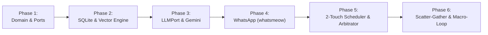

# SDD Proposal: WhatsApp Adaptive Learning AI Harness

## 1. Executive Summary
This proposal defines the construction of an autonomous, energy-adaptive AI learning coach operating over WhatsApp. The system eliminates cognitive inertia and activation friction by dynamically matching learning activities to the user's real-time mental bandwidth, enforcing a strict two-touch daily budget, and treating grounded subjects as isolated Bounded Context Bags.

---

## 2. Problem Statement & Job-to-be-Done (JTBD)
* **The Struggle**: Professionals with high ambition face high cognitive resistance when initiating deliberate practice (reading, problem-solving, watching lectures) after demanding workdays. Rigid scheduling tools assume uniform cognitive energy, triggering guilt and abandonment.
* **JTBD**: *"When my cognitive energy fluctuates throughout the day, dynamically match learning friction to my mental state—delivering deep exercises when fresh and zero-friction active-recall drills when depleted—so my habit momentum never drops to zero."*

---

## 3. Scope Boundaries

### In Scope
1. **Core Domain & Multi-Tenancy**: Pure Go domain aggregates (`User`, `LearningPath`, `MasteryLedger`, `TouchpointSession`) with strict `user_id` data isolation from Day 1.
2. **Two-Touch Daily Proactive Loop**:
   * *8:00 AM Morning Catalyst*: Designates **The ONE Most Important Thing** across active paths to eliminate choice paradox, serving a 2-minute in-chat micro-drill.
   * *8:00 PM Evening Streak Saver*: Serves a 15-second recall card when energy is depleted; enforces a strict zero-nag backoff policy if left on read.
3. **Grounded Bounded Contexts (Learning Paths)**: Ingests reference materials (e.g. *RDD*, *Algorithms*) into SQLite with local vector similarity search for grounded drill generation and active recall.
4. **Hierarchical Routing & Federation**:
   * Isolates active drill grading from spontaneous queries.
   * Path Affinity Classifier unbinds path-specific Context Bags.
   * Scatter-Gather federation for cross-domain inquiries spanning multiple paths.
5. **Macro-Loop Mentorship**: Analyzes mastery progress and collaboratively negotiates next roadmap milestones (*RDD $\rightarrow$ Design Patterns*).

### Non-Goals (Out of Scope for MVP)
* **Email Integration**: Excluded per YAGNI (high privacy surface area, zero alignment with core learning loop).
* **External Managed Vector DBs**: Excluded to avoid premature infrastructure complexity; SQLite vector similarity is used.
* **Meta Cloud API Setup**: Deferred in favor of a local `whatsmeow` multi-device QR pairing for frictionless MVP iteration.

---

## 4. Technical Architecture & Technology Stack
* **Language & Runtime**: Go (Golang) — single compiled binary, lean memory footprint (~30MB), native concurrency.
* **Architecture Pattern**: **Hexagonal Architecture (Ports & Adapters)**:
  * `internal/core/domain`: Zero external dependencies, pure business invariants.
  * `internal/core/ports`: Strict Go interfaces for `MessagingPort`, `SourceCorpusPort`, `CalendarTelemetryPort`, `LLMPort`, and `RepositoryPort`.
  * `internal/adapters`: Swappable concrete drivers (`whatsmeow`, SQLite, Gemini).
* **Storage & Vectors**: SQLite with embedded vector similarity (`BLOB` cosine search or `sqlite-vec`), strictly partitioned by `user_id`.
* **Intelligence Layer**: Google Gemini as the initial default adapter behind `LLMPort`, fully swappable via configuration.

---

## 5. Phased Implementation Roadmap

1. **Phase 1: Domain Invariants & Hexagonal Ports**
   * Implement pure Go aggregates: `User`, `LearningPath`, `MasteryLedger`, `TouchpointSession`.
   * Define driven and driving ports in `internal/core/ports`.
   * Unit test domain logic with strict TDD.

2. **Phase 2: Persistence & Local Vector Store**
   * Implement SQLite schema with `user_id` multi-tenant boundaries.
   * Build local chunk ingestion and cosine similarity search engine.

3. **Phase 3: Decoupled LLM Adapter (`LLMPort`)**
   * Build `adapters/llm/gemini` for micro-drill generation, answer evaluation, and embedding creation.
   * Implement deterministic schema validation and length guardrails.

4. **Phase 4: WhatsApp Multi-Device Transport Adapter**
   * Implement `adapters/whatsapp` using `whatsmeow`.
   * Provide QR code terminal pairing and inbound message routing.

5. **Phase 5: Proactive Scheduler & Attention Arbitrator**
   * Build background cron runner for 8:00 AM and 8:00 PM touchpoints.
   * Implement the Attention Arbitrator to designate "The ONE Thing" and enforce zero-nag backoff.

6. **Phase 6: Multi-Path Router & Cross-Domain Scatter-Gather**
   * Build Hierarchical Path Affinity Classifier.
   * Implement Scatter-Gather query federation across multiple active paths.
   * Build Macro-Mentorship milestone recommendation service.

---

## 6. Risks & Mitigations

| Risk | Impact | Mitigation Strategy |
| :--- | :--- | :--- |
| **WhatsApp Multi-Device Protocol Shifts** | Medium | Isolated behind `MessagingPort`. Can swap to official Meta Cloud API by changing a single adapter file. |
| **Cognitive Misalignment (User Annoyance)** | High | Strict 2-touch notification budget, zero-nag policy, and 15-second fallback cards to eliminate friction. |
| **LLM Output Hallucination / Drift** | Medium | Deterministic validation invariants in Go; drills strictly grounded in SQLite vector chunks. |
| **Scope Creep** | High | Hard boundary set: Email dropped, single-binary SQLite architecture enforced. |
