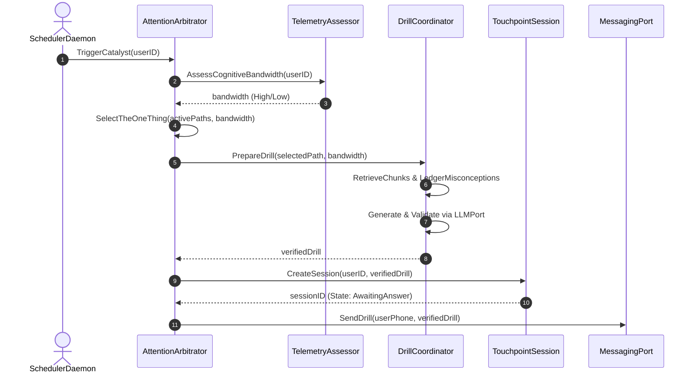
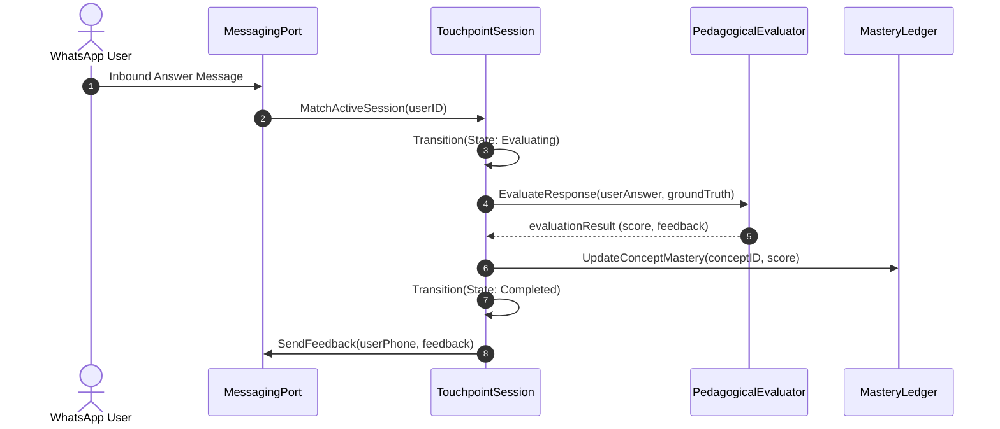
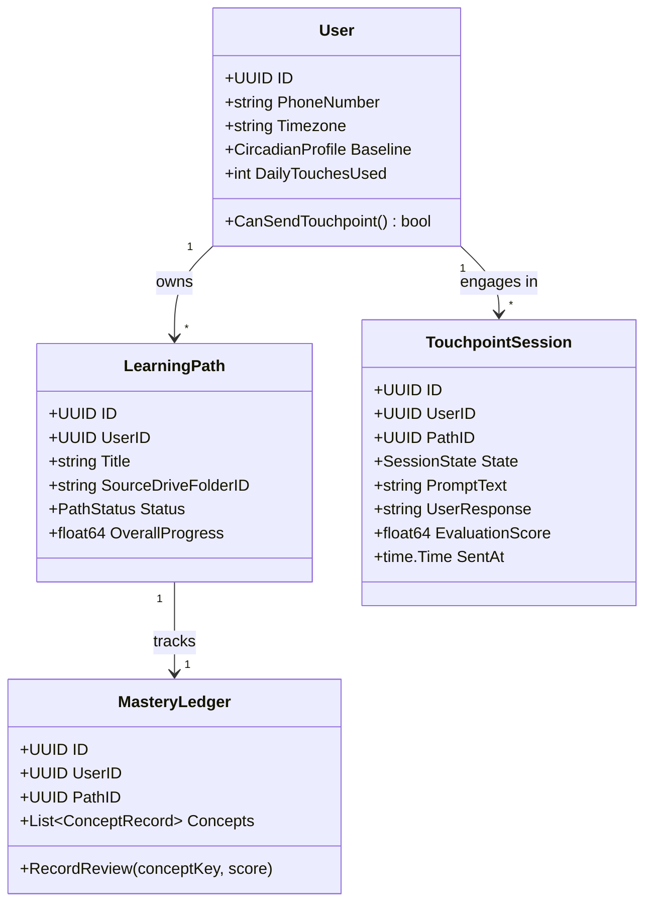
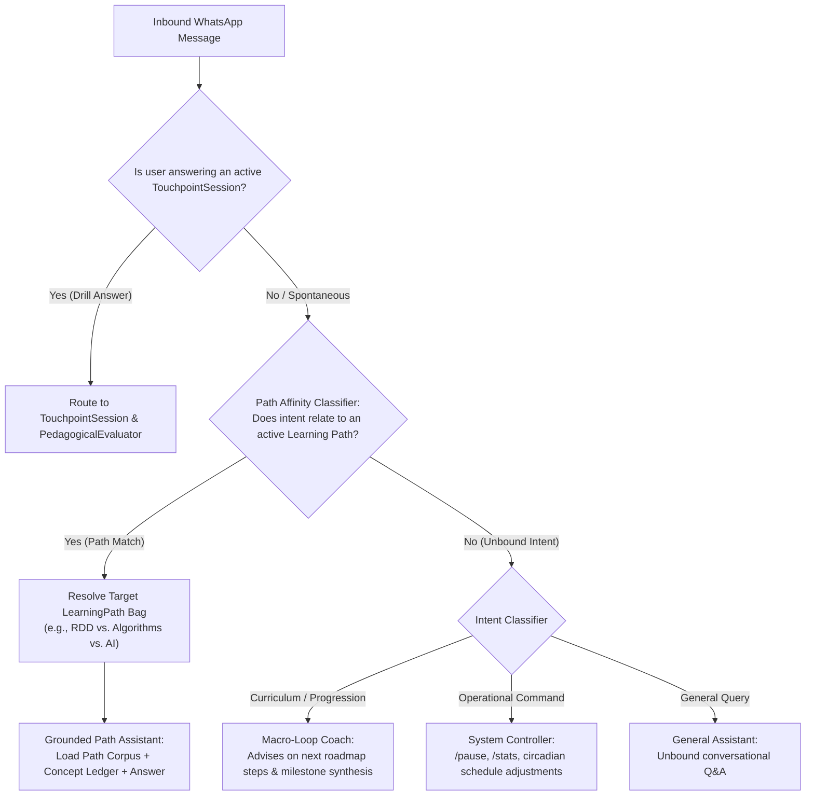
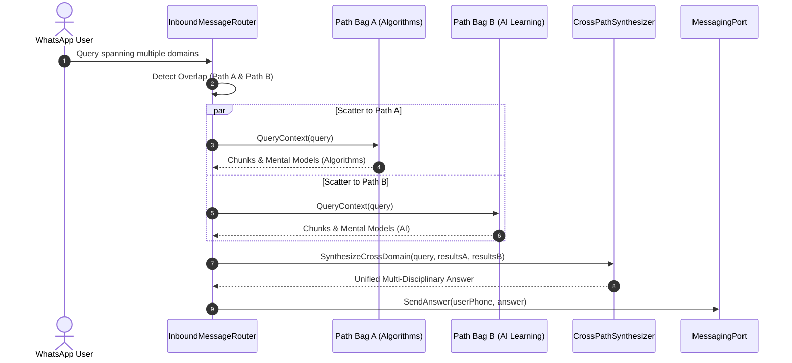

# Domain Model & Object Interactions (RDD Approach)

Applying **Responsibility-Driven Design (Wirfs-Brock)**: We first define the core **Use Cases**, discover **Candidate Objects and their Roles**, and map their **Collaborations**.

---

## 1. Core Use Cases

### UC-1: Trigger Morning Catalyst (The ONE Thing)
- **Primary Actor**: System Timer (`SchedulerDaemon`).
- **Preconditions**: Daily notification budget has not been exhausted for `User`.
- **Flow**:
  1. `SchedulerDaemon` triggers daily catalyst for `User`.
  2. `TelemetryAssessor` queries calendar meeting density to infer today's `CognitiveBandwidth` (High/Low).
  3. `AttentionArbitrator` evaluates all active `LearningPath`s and designates **The ONE Thing** to prioritize.
  4. `DrillCoordinator` retrieves relevant `GroundedChunk`s from the path corpus and pulls past misconceptions from `MasteryLedger`.
  5. `DrillCoordinator` prompts `LLMPort` to format a single micro-drill matching the user's cognitive bandwidth.
  6. `TouchpointSession` is initialized in state `AWAITING_ANSWER`.
  7. `MessagingPort` dispatches the drill to WhatsApp.

---

### UC-2: Process Inbound Learner Response
- **Primary Actor**: `User` (via WhatsApp message).
- **Preconditions**: An active `TouchpointSession` is in state `AWAITING_ANSWER`.
- **Flow**:
  1. Inbound message received via `MessagingPort`.
  2. `TouchpointSession` captures user answer and transitions to `EVALUATING`.
  3. `PedagogicalEvaluator` checks user answer against `GroundedChunk` source truths via `LLMPort`.
  4. `MasteryLedger` updates concept retention score and spaced repetition interval for the tested concept.
  5. `TouchpointSession` records evaluation and transitions to `COMPLETED`.
  6. Feedback message is formatted and sent back to user via `MessagingPort`.

---

### UC-3: Evening Micro-Streak Check-In
- **Primary Actor**: System Timer (`SchedulerDaemon`).
- **Flow**:
  1. `SchedulerDaemon` inspects user activity for the day.
  2. If morning drill was completed, sends celebratory micro-reflection.
  3. If morning was missed (or user had a brutal day), serves a zero-friction 15-second recall card to keep momentum alive.
  4. Touchpoint budget marks 2/2 used for the day; system enters silent backoff.

---

### UC-4: Milestone Synthesis & Curriculum Steering (Macro-Loop)
- **Primary Actor**: `MasteryLedger` / `User`.
- **Flow**:
  1. `LearningPath` reaches target mastery threshold across its concept ledger.
  2. `CurriculumPlanner` synthesizes acquired mental models and queries `CurriculumGraph` for logical next steps (e.g. *RDD $\rightarrow$ Design Patterns*).
  3. Coach proactively proposes the next path with architectural reasoning.
  4. User accepts, modifies, or redirects the recommendation.

---

## 2. Candidate Domain Objects & Stereotypes

| Candidate Object | RDD Stereotype | Primary Responsibility |
| :--- | :--- | :--- |
| **`User`** | Information Holder | Holds identity, phone number, circadian baseline, and daily touchpoint counters. |
| **`LearningPath`** | Information Holder | Encapsulates topic corpus reference, completion status, and active concepts. |
| **`MasteryLedger`** | Information Holder | Tracks concept comprehension scores, active misconceptions, and spaced-repetition schedules. |
| **`GroundedChunk`** | Information Holder | Normalized text slice with vector embedding from source books/notes. |
| **`TouchpointSession`** | Controller / State Machine | Manages lifecycle of a daily interaction (`PENDING` $\rightarrow$ `AWAITING_ANSWER` $\rightarrow$ `COMPLETED` $\rightarrow$ `EXPIRED`). |
| **`TelemetryAssessor`** | Service Provider | Translates calendar density and time-of-day into estimated `CognitiveBandwidth`. |
| **`AttentionArbitrator`** | Coordinator | Solves decision fatigue: picks the single highest-leverage path/topic for the morning. |
| **`DrillCoordinator`** | Coordinator | Assembles context, orchestrates LLM drill generation, and enforces validation invariants. |
| **`CurriculumPlanner`** | Structurer | Maintains the prerequisite dependency graph between paths (*RDD $\rightarrow$ Patterns $\rightarrow$ Compilers*). |

---

## 3. Collaboration Diagram: Morning Touchpoint (UC-1)

---

## 4. Collaboration Diagram: Inbound Response (UC-2)

---

## 5. Domain Aggregate Boundaries (DDD)

---

## 6. Hierarchical Routing & Learning Path "Context Bags"

A **`LearningPath` is a Bounded Context Window Bag**: it encapsulates grounded source vectors, concept masteries, and topic-specific pedagogical notes.

When an inbound message arrives, it is processed through a **Hierarchical Classifier Pipeline**:

### Router Responsibilities:
1. **Drill State Guard**: Isolates active evaluations so casual questions don't corrupt spaced-repetition scores.
2. **Path Affinity Classifier**: Matches message semantics against registered path keywords, concepts, and embeddings to pick the right **Context Bag**.
3. **Macro-Loop Fallback**: When the user asks about the future (*"What should I study after RDD?"*), routes to the **Macro Coach** for prerequisite guidance.
4. **Command Controller**: Intercepts utility requests (*"Pause today"*, *"Change morning time to 9 AM"*).

---

## 7. Cross-Path Federated Query (Scatter-Gather Pattern)

When a spontaneous inquiry spans multiple active Learning Paths (e.g., asking about *Graph Algorithms applied in AI Neural Networks*), the system avoids asking the user to choose. Instead, it executes an internal **Scatter-Gather Federation**:

- **Invariant**: Bounded Context isolation is preserved. Retrieving chunks from Path A and Path B does NOT cross-contaminate their independent `MasteryLedger` states.
